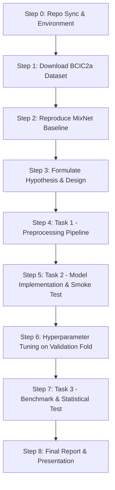

# MI-EEG Classification Pipeline: MixNet Deconstruction & Assignment Plan

This document outlines:
1. **The Step-by-Step Assignment Roadmap** (from setup and baseline reproduction to benchmarking and report).
2. **Deconstruction of MixNet's Designable Components** (preprocessing, neural network architecture, loss formulations, and training dynamics).
3. **Concrete Method Ideas & Hypotheses** you can adopt for your custom pipeline (`HW_prep.py` & `HWNet.py`).

---

## 1. Step-by-Step Execution Roadmap



### Step 0: Sync Homework Codebase & Set Up Environment
- The current folder `frontier-hw-bci` only contains the overview PDF and README. Pull or copy the official homework branch files from [xydxdy/MixNet (homework branch)](https://github.com/xydxdy/MixNet/tree/homework) into this repository.
- **Python & CUDA Environment**:
  - The repo requires Python 3.8 and TensorFlow (`tensorflow-gpu==2.7.0` or TF 2.x).
  - *Hardware note*: The workstation has NVIDIA RTX 4090 GPUs (Ada Lovelace, compute capability 8.9). Older TF 2.7 wheels predate Ada Lovelace, so verify CUDA runtime and cuDNN compatibility in a dedicated Conda environment.

### Step 1: Download BCIC2a Dataset
- Execute:
  ```bash
  cd experiments
  python download_datasets.py --dataset 'BCIC2a'
  ```
- This downloads BCI Competition IV-2a (9 subjects: `A01` to `A09`, sessions `T` and `E`) into `experiments/datasets/BCIC2a/raw/`.
- **Session T**: Used for 5-fold stratified cross-validation (training + validation).
- **Session E**: Untouched test set evaluated at the end of each fold.

### Step 2: Reproduce the MixNet Baseline (Mandatory First Milestone)
- Run baseline preprocessing:
  ```bash
  cd experiments
  python prep_spectral_spatial_signals.py --dataset 'BCIC2a' --setting 'dependent'
  ```
- Train MixNet across all 9 subjects with paper hyperparameters:
  ```bash
  python run_MixNet.py \
      --model_name 'MixNet' \
      --dataset 'BCIC2a' \
      --train_type 'subject_dependent' \
      --data_type 'spectral_spatial_signals' \
      --adaptive_gradient True \
      --policy 'HistoricalTangentSlope' \
      --log_dir 'logs' \
      --num_class 2 \
      --GPU 0 \
      --margin 1.0 \
      --n_component 2 \
      --warmup 7
  ```
- Generate baseline benchmark summary:
  ```bash
  python benchmark.py
  ```
- Save `benchmark_per_subject.csv` and `benchmark_summary.csv`. This establishes the official reference benchmark to beat or compare against.

### Step 3: Formulate Your Core Hypothesis
- Choose what scientific question or physiological property you want to investigate.
- Examples:
  - *Hypothesis 1 (End-to-End Spatio-temporal filtering)*: Pre-computed CSP removes continuous temporal phase and frequency band interactions. Learning temporal FIR filters and spatial depthwise filters end-to-end directly from raw EEG will better preserve phase-amplitude coupling.
  - *Hypothesis 2 (Riemannian Geometry Manifold)*: Motor imagery changes are covariance-based (ERD/ERS). Mapping trial covariance matrices directly to Riemannian tangent space linearizes manifold distances and mitigates subject-to-subject non-stationarity.
  - *Hypothesis 3 (Multi-Scale Temporal Attention)*: Motor imagery generates both brief transient bursts and steady rhythms; multi-scale temporal convolutions combined with channel attention (Squeeze-and-Excitation) will better isolate active sensorimotor rhythms ($C_3, C_4, C_z$).

### Step 4: Task 1 — Implement Preprocessing (`mixnet/preprocessing/BCIC2a/HW_prep.py`)
- Implement:
  1. `fit_transform(X, y, pick_smp_freq, **kwargs)`: Learned parameters fitted **only on the training fold**. Return `(X_out, state)`.
  2. `transform(X, state, pick_smp_freq, **kwargs)`: Pure transform applying `state` to validation and test folds without refitting.
- Run preprocessing:
  ```bash
  python prep_HW.py
  ```
- Verify 270 `.npy` files are generated in `experiments/datasets/BCIC2a/HW_prep/2_class/subject_dependent/`.

### Step 5: Task 2 — Implement Model (`mixnet/models/HWNet.py`) & Smoke Test
- Implement:
  - `_config()`: Model-specific hyperparameter declarations.
  - `build()`: Model definition returning a `tf.keras.models.Model` named `self.model_name`.
- Configure `experiments/configs/HWNet.py` (matching `input_shape` and `data_format`).
- **Smoke test**: Start with a simple 2-layer MLP to ensure the entire pipeline (data loader -> trainer -> evaluate -> logs) executes cleanly on subject 1.
- Replace with your hypothesized architecture.

### Step 6: Hyperparameter Tuning (Validation Set ONLY)
- Tune learning rate, batch size, dropout, weight decay, and kernel sizes via `experiments/configs/HWNet.py`.
- **Golden Rule**: Never inspect or optimize hyperparameters against Session E. Tuning must be guided strictly by 5-fold cross-validation loss/accuracy on Session T.

### Step 7: Task 3 — Benchmark & Statistical Testing
- Run full 9-subject evaluation:
  ```bash
  python run_HWNet.py
  ```
- Run paired comparison:
  ```bash
  python benchmark.py --baseline MixNet --candidate HWNet
  ```
- Examine:
  - Overall mean accuracy & F1-score across 9 subjects.
  - Per-subject breakdown (identify which subjects improved and which did not).
  - Paired t-test / Wilcoxon signed-rank test p-values.

### Step 8: Final Report & Presentation
- Write a 3–5 page conference-style report addressing:
  - Motivation and hypothesis.
  - Design choices and mathematical justification.
  - Verification of zero data leakage.
  - Per-subject and statistical comparison against MixNet.
  - Discussion of limitations, negative/positive results, and future directions.
- Prepare the 15-minute presentation.

---

## 2. Deconstruction of MixNet: The 4 Designable Components

MixNet combines classical signal processing (Common Spatial Patterns across sub-bands) with modern deep multi-task representation learning. Every stage of this pipeline is modular and can be modified or replaced.

```
+---------------------------------------------------------------------------------------------------------+
|                                        MIXNET COMPLETE PIPELINE                                         |
|                                                                                                         |
|  [Raw EEG] ---> [Component 1: Preprocessing] ---> [Component 2: Backbone] ---> [Component 3 & 4: Loss]   |
|  (20 ch, 400t)    - 10 Sub-bands                   - Temporal Conv 1D           - Reconstruction (MSE)  |
|                   - Band-wise CSP                  - Pooling & Bottleneck       - Triplet Metric Loss   |
|                   - Spatial signals (20, 400)      - Latent space z             - Softmax Cross-Entropy |
|                                                    - Conv2DTranspose Decoder    - Adaptive Grad Blending|
+---------------------------------------------------------------------------------------------------------+
```

### Component 1: Preprocessing & Feature Representation (`HW_prep.py`)

#### What MixNet Does
1. **Frequency Decomposition**: Divides the $4\text{ s}$ EEG signal ($100\text{ Hz} = 400$ samples, 20 channels) into multiple overlapping/non-overlapping frequency bands (e.g. 10 bands spanning $4-40\text{ Hz}$, capturing $\theta, \mu, \beta$ rhythms).
2. **Sub-Band Common Spatial Pattern (CSP)**:
   - For each band $b$, computes average spatial covariance matrices for each class ($C_1, C_2$).
   - Solves generalized eigenvalue decomposition:
     $$C_1 w = \lambda (C_1 + C_2) w$$
   - Retains $m=2$ spatial filters per band (extremal eigenvalues maximizing variance of one class while minimizing the other).
3. **Spectral-Spatial Signal Generation**:
   - Multiplies filters by bandpass-filtered signals: $S_b = W_b^T X_b$.
   - Concatenates across bands to produce a $(B \cdot m, T) = (20, 400)$ continuous spatial-spectral time series.

#### Designable Axes for Your Pipeline
| Option | Description | Output Shape | Pros / Cons |
|---|---|---|---|
| **Raw Time-Domain EEG** | Standard bandpass filter ($4-38\text{ Hz}$) + Z-score normalization per channel | `(20, 400)` | Retains all temporal and phase information; relies on neural net to learn spatial & spectral filters. |
| **Classical FBCSP Log-Variance** | Filter bank + CSP, followed by log-variance computation: $f = \log(\text{var}(S))$ | `(2 \cdot m \cdot B,)` (e.g. 40-dim vector) | Highly compact; classical SOTA for BCI; ignores intra-trial temporal dynamics. |
| **Riemannian Tangent Space** | Computes SPD covariance matrix $P_i = \frac{1}{T} X_i X_i^T$, finds Riemannian Fréchet mean $\bar{P}$, and projects to tangent space | `(210,)` vector for 20 channels | Geometrically principled, robust to noise and artifacts; loses within-trial temporal dynamics. |
| **Time-Frequency Representation (STFT / Wavelet)** | Continuous Wavelet Transform (Morlet) or STFT on motor channels ($C_3, C_z, C_4$) | `(Channels, Frequencies, Time)` | Directly visualizes Event-Related Desynchronization (ERD); higher input dimension. |
| **Spatial Filtering Alternatives** | Surface Laplacian, Common Average Reference (CAR), or Bipolar derivations | `(20, 400)` | Stateless spatial filtering; eliminates reference electrode bias without data leakage risks. |

> [!IMPORTANT]
> **Data Leakage Check**:
> - **Stateful operations** (CSP eigenvalues, Riemannian mean, global mean/variance scalers, PCA): **MUST** be fitted inside `fit_transform()` on the training fold, saved into `state`, and only applied in `transform()`.
> - **Stateless operations** (Butterworth bandpass, CAR, per-trial Z-score, log-variance, STFT): Can be applied directly.

---

### Component 2: Neural Network Architecture (`HWNet.py`)

#### What MixNet Does
- **Encoder**:
  - `Conv2D(F1=20, (1, 64), activation='elu')`: Temporal 1D convolution across time steps (filter length 64 = $640\text{ ms}$).
  - `BatchNormalization` + `AveragePooling2D((1, 100//100) = (1, 1))`.
  - `Conv2D(F2=10, (1, 32), activation='elu')`: Second temporal convolution.
  - `AveragePooling2D((1, 4))`: Downsampling time.
  - `Flatten()` + `Dense(LATENT_DIM)`: Projection into latent representation $z$ ($\text{dim}=20$).
  - Max-norm weight constraints on conv and dense layers.
- **Decoder Branch**:
  - Dense expansion from $z$ + `Reshape`.
  - `Conv2DTranspose` layers reconstructing the original $(1, 400, 20)$ spectral-spatial signal.
- **Classification Branch**:
  - Linear classifier `Dense(num_class, activation='softmax')` operating on latent vector $z$.

#### Designable Axes for Your Architecture
1. **Convolutional Factorization**:
   - *Temporal-then-Spatial*: As in **EEGNet**, apply a 2D temporal convolution $(1, K_t)$, followed by a depthwise spatial convolution $(C, 1)$ across all channels, followed by separable convolutions.
   - *Multi-Scale Kernels*: Parallel temporal conv branches with sizes 16, 32, 64 ($160\text{ ms}, 320\text{ ms}, 640\text{ ms}$) to capture both fast $\beta$ oscillations and slower $\mu$ waves.
2. **Attention & Contextual Modeling**:
   - *Channel Attention (Squeeze-and-Excitation)*: Dynamically recalibrates channel importance depending on which motor hemisphere is active.
   - *Temporal Self-Attention / Transformer*: Captures long-range dependencies across the 4-second motor imagery window.
3. **Recurrent / Temporal Dynamics**:
   - CNN feature extractor feeding into a GRU or Bidirectional LSTM to model sequential state transitions during motor execution.
4. **Regularization & Stability**:
   - `Dropout` (0.25 to 0.5): Essential in EEG due to high noise-to-signal ratio and small trial counts (144 trials per session).
   - `max_norm(1.0)` or `max_norm(2.0)` on convolutional kernels to constrain weight explosion.

---

### Component 3: Objective Functions & Multi-Task vs Single-Task Paradigm

#### What MixNet Does
MixNet optimizes a multi-objective loss function:
$$\mathcal{L}_{total} = w_{mse} \mathcal{L}_{mse}(x, x_r) + w_{trp} \mathcal{L}_{triplet}(y, z) + w_{ce} \mathcal{L}_{ce}(y, \hat{y})$$
1. **$\mathcal{L}_{mse}$ (Reconstruction)**: Forces latent space $z$ to preserve informative signal structure and act as an autoencoder.
2. **$\mathcal{L}_{triplet}$ (Deep Metric Learning)**: Enforces semi-hard triplet distance margin ($m=1.0$), pushing embeddings of same-class motor imagery closer while pulling opposite classes apart.
3. **$\mathcal{L}_{ce}$ (Sparse Categorical Cross-Entropy)**: Predicts final left vs. right hand class.

#### Single-Task vs Multi-Task in Your Homework
- **Single-Task (Recommended starting point)**:
  - Model outputs single softmax tensor: `Model(inputs=input1, outputs=softmax, name=self.model_name)`.
  - Uses default `train_step`, `val_step`, and `test_step` in `HWNet.py`.
  - Cleaner to tune, easier to debug, and evaluated directly by `base.py` without requiring custom overrides.
- **Multi-Task**:
  - Allowed if properly motivated by your hypothesis, but requires:
    1. Returning a list of outputs with softmax last: `[aux_out, ..., softmax]`.
    2. Overriding `evaluate()` in `HWNet.py`.
    3. Updating loss names, weights, and step functions.
    4. Running ablation experiments (showing the contribution of each auxiliary loss).

#### Alternative Loss Formulations
- **Label Smoothing Cross-Entropy**: Prevents overconfident predictions on noisy EEG labels.
- **Focal Loss**: Focuses gradients on hard-to-classify trials.
- **Supervised Contrastive Loss (SupCon)**: Extends triplet loss to contrast all positive and negative pairs in the batch.
- **Center Loss**: Penalizes Euclidean distances between latent features and their learned class centers.

---

### Component 4: Optimization Dynamics & Hyperparameters (`configs/HWNet.py`)

#### What MixNet Does
- **Adaptive Gradient Blending (`HistoricalTangentSlope`)**: Automatically balances gradient contributions between the reconstruction, triplet, and classification losses during training.
- **Optimizer**: Adam with learning rate $10^{-3}$.
- **Batch Size**: 10 or 32.
- **Early Stopping**: Validation loss patience (typically 20–30 epochs) to prevent overfitting.
- **Epochs**: Up to 200 epochs.

#### Designable Hyperparameters in `experiments/configs/HWNet.py`
```python
model_params = {
    'input_shape': (1, 400, 20),      # Must match output of DataLoader._change_data_format
    'num_class': 2,
    'dropout_rate': 0.5,              # Tune between 0.2 and 0.5
    'kernel_length': 32,              # Temporal filter width
    'n_filters': 16,                  # Temporal filter capacity
    'latent_dim': 32,
}

data_params = {
    'data_format': 'channels_last',   # 'channels_last' or 'channels_first'
    'batch_size': 32,                 # Typically 16, 32, or 64
}

train_params = {
    'lr': 1e-3,                       # 1e-3, 5e-4, 1e-4
    'es_patience': 30,                # Early stopping patience
    'epochs': 200,
}
```

---

## 3. Recommended Strategies for "Our Own Method"

Here are three concrete, scientifically sound hypotheses you can pursue:

### Strategy A: End-to-End Spatio-Temporal Network on Raw Filtered EEG (EEGNet / ConvNet Style)
- **Concept**: Skip CSP entirely. Preprocess by bandpass filtering ($4-38\text{ Hz}$) and Z-scoring channels. Feed raw `(20, 400)` trials into an EEGNet-style architecture.
- **Architecture**:
  1. 2D Temporal Conv: `(1, 32)` filters learning frequency filters.
  2. Depthwise Spatial Conv: `(20, 1)` learning spatial combinations across all 20 electrodes.
  3. Separable Conv: `(1, 16)` temporal summary + pointwise combination.
  4. Global Average Pooling + Dropout(0.5) + Dense(2, 'softmax').
- **Hypothesis**: *Data-driven spatial filtering learned jointly with classification loss outperforms decoupled two-stage CSP feature extraction because CSP overfits on small trial counts.*

### Strategy B: Filter Bank + CSP + Multi-Scale Temporal Convolutions (Hybrid Approach)
- **Concept**: Retain MixNet's Spectral-Spatial signals `(20, 400)`, but replace MixNet's simple 1D CNN with multi-scale temporal convolutions + Squeeze-and-Excitation channel attention.
- **Architecture**:
  1. Three parallel branches with kernel sizes 16, 32, and 64 samples ($160\text{ ms}, 320\text{ ms}, 640\text{ ms}$).
  2. Concatenate feature maps across branches.
  3. Channel Attention (Squeeze-and-Excitation block) to weight active sub-band CSP signals.
  4. Average Pooling + Dense Classifier.
- **Hypothesis**: *Motor imagery induces variable-frequency ERD bursts across distinct temporal scales; multi-scale receptive fields capture both transient high-$\beta$ dynamics and sustained $\mu$ suppression.*

### Strategy C: Riemannian Tangent Space Features + MLP / 1D-CNN
- **Concept**: Compute the covariance matrix of each trial, project onto the Riemannian manifold tangent space at the geometric mean covariance, and classify with an MLP.
- **Hypothesis**: *EEG covariance matrices are non-Euclidean; Riemannian geometry linearizes manifold distances, eliminating inter-trial variance and yielding superior sample efficiency on small datasets.*

---

## 4. Summary Checklist

- [ ] Confirm baseline reproduction completes and generates `benchmark_per_subject.csv`.
- [ ] Ensure `fit_transform()` only touches the training fold and stores all parameters in `state`.
- [ ] Ensure `transform()` only reads from `state` without recalculating statistics.
- [ ] Verify input/output dimensions align across `HW_prep.py`, `DataLoader`, and `HWNet.py`.
- [ ] Verify validation-only tuning (Session E left untouched until benchmark evaluation).
- [ ] Run `python benchmark.py --baseline MixNet --candidate HWNet` to get paired comparison and p-values.
